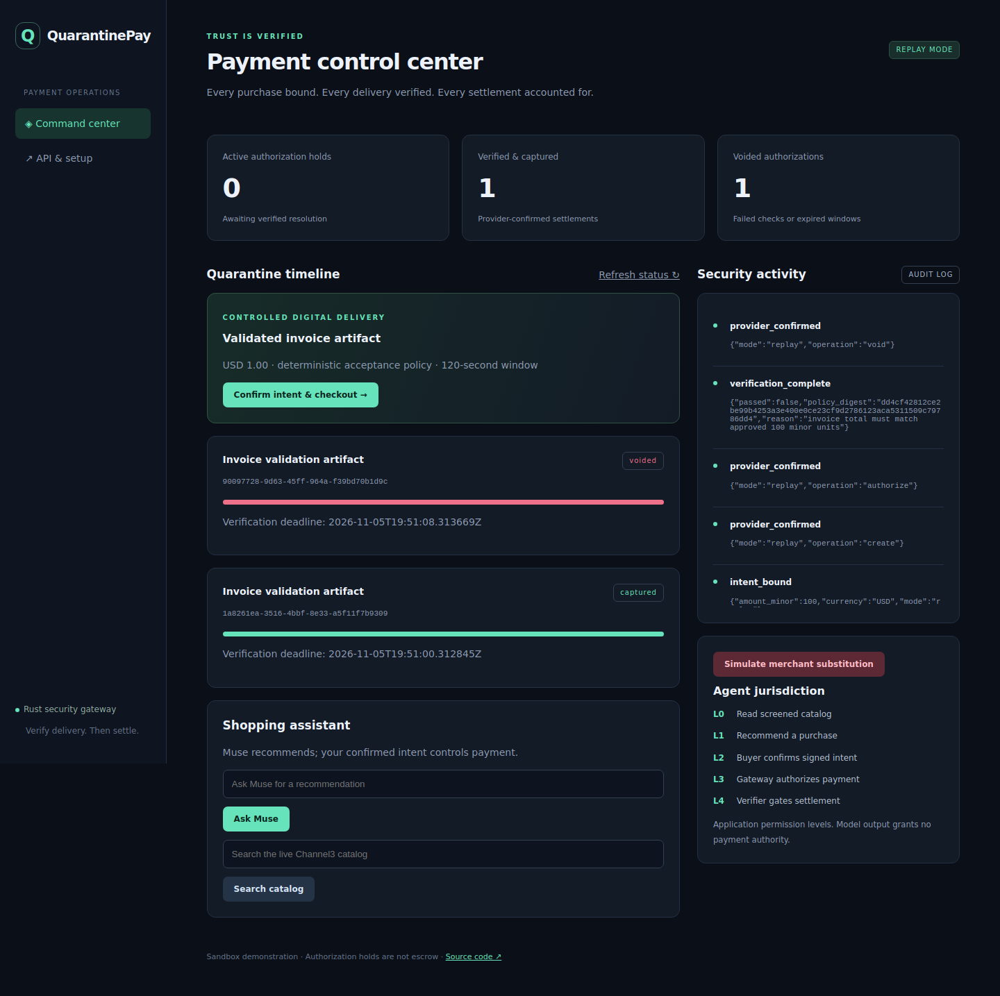

# QuarantinePay

**Verify delivery. Then settle.** A Rust payment control center for agent-assisted purchases: buyer-confirmed Ed25519 intents, PayPal authorization holds, a bounded deterministic verifier, and durable capture/void operations.

## Run locally

Requires stable Rust, PostgreSQL 16+, and (for the live browser timeline) `wasm32-unknown-unknown` plus `wasm-bindgen-cli` matching the lockfile, currently 0.2.130.

1. Create a PostgreSQL database and set `DATABASE_URL`. Copy `.env.example` to `.env` **only if you do not already have a credential file**.
2. Set `QP_MODE=replay` for offline payment demonstrations. Set a random `QP_ADMIN_PASSWORD` of at least 24 characters, or let the server generate one in `.local/admin-password`.
3. For the local assistant, install `zstd`, run `make local-model-install`, then `make local-model-serve` in another terminal and `make local-model-pull` once. The selected Qwen3 model downloads about 19 GB; a 32 GB NVIDIA GPU supports the validated configuration.
4. Run `make build` (or `cargo build --workspace` for the server and verifier without browser enhancements).
5. Run `RUST_LOG=info cargo run -p quarantinepay-server` from the repository root. Open `http://localhost:3000`.
6. If no password was configured, read the generated password locally with `od -An -v -tx1 .local/admin-password | tr -d ' \n'`. Do not share it or commit it.

Payment replay and automated tests work without a GPU or model download. The local assistant and listing classifier require the model runtime. Restart the server after changing credentials or inference configuration.

The UI works through native HTML forms without JavaScript. The optional Rust/WASM module adds live event-driven refresh and deadline countdowns. JavaScript files are WASM loading/binding glue only.

### Live Sandbox

Set `QP_MODE=sandbox`, `PAYPAL_CLIENT_ID`, `PAYPAL_CLIENT_SECRET`, and `PAYPAL_MERCHANT_ID` to the **same Sandbox business account**. The merchant ID is the 13-character account identifier, distinct from the REST application Client ID. REST authentication uses `PAYPAL_CLIENT_SECRET`; no separate merchant secret is required. Configure an HTTPS public URL in `QP_PUBLIC_BASE` and register `/api/webhooks/paypal`, setting `PAYPAL_WEBHOOK_ID` to its webhook ID. Use a separate Sandbox buyer account for approval.

Click **Confirm intent & checkout**, wait for the approval link, approve at PayPal, then click **Confirm approval / authorize**. Authorization only succeeds after PayPal reports buyer approval. Submit the passing or failing fixture within 120 seconds. Refresh manually if WASM assets were not built.

The demo SKU costs USD 1.00. It purchases a JSON invoice fixture, not a physical Channel3 product. Capture/void are internal worker operations and are never exposed to the model. The application disables production PayPal endpoints.

### Integrations

- **Local Qwen (default):** `QP_PRIVATE_INFERENCE=true`, `QP_INFERENCE_PROVIDER=local`, `QP_LOCAL_LLM_BASE=http://127.0.0.1:11434`, and `QP_LOCAL_MODEL=qwen3:30b-instruct`. Prompts and product text are processed locally; no cloud fallback is implemented. See [privacy boundaries](docs/PRIVACY.md).
- **Meta Muse (explicit opt-in):** set `QP_PRIVATE_INFERENCE=false` and `QP_INFERENCE_PROVIDER=muse`, then configure `MUSE_API_KEY` (or `MODEL_API_KEY`), `MUSE_MODEL`, `MUSE_API_BASE`. The cloud provider uses Meta's API and `muse-spark-1.1` when explicitly enabled. Recommendations are displayed in security activity and have no payment authority.
- **Channel3:** `CHANNEL3_API_KEY` plus `QP_PRIVATE_INFERENCE=false` enables real catalog search. Private mode searches the local demo catalog. Results are screened and explicitly labeled discovery-only. Missing keys produce a clear error; replay does not fabricate live catalogs.
- **Elasticsearch 8+:** `ELASTIC_URL` and `ELASTIC_API_KEY` enable a 128-dimensional dense-vector index, seeded at startup with three labeled attack examples. The key needs index creation, document write, and search access. Embeddings use deterministic hashed token features, **not a trained security classifier**. The local model classifies listing text before vector screening. With no Elastic URL, local classification and heuristics remain available. Private mode requires a loopback Elastic URL. Configured-but-failing screening withholds catalog results.

## Security and settlement

The authenticated buyer confirms the server-priced SKU, merchant, amount, and currency. The gateway signs those fields together with buyer identity, nonce, expiry, version, and acceptance-policy digest. Reconstructed typed serialization gives a fixed signature representation. Unknown fields are rejected; altered, expired, cross-buyer, or reused intents cannot create an order. Merchant and price are server allowlisted.

Payment lifecycle: `create_pending → approval_pending → authorize_pending → authorized → quarantined → capture_pending/void_pending → captured/voided`. An expired delivery window or expired intent after authorization leads to void processing. Expired intents cannot initiate order creation, authorization, or capture; uncertain pending effects instead require reconciliation. Provider-confirmed results determine settlement; ambiguous outcomes remain pending and eventually become `reconciliation_required`.

Replay and Sandbox intents and orders are stored with their payment mode. The dashboard, API, and worker use only the currently configured mode, and an intent cannot cross modes. Existing records migrate as replay data. PostgreSQL transactions consume each intent once. Workers serialize work using transaction-scoped advisory locks and persist stable request IDs before network effects. HTTP 401/403 refusals immediately stop automatic retries, preserve the authorization/request ID, and emit a sanitized audit event including PayPal's debug ID. Unknown outcomes and other failures retain stable request IDs, with retries stopping after five minutes. Webhooks are signature-verified through PayPal and deduplicated; the worker independently reads provider state and reconciles pending operations. A webhook never authorizes capture. For `reconciliation_required`, an operator must inspect the PayPal order/authorization before deciding the next action; no automatic replacement purchase occurs.

The acceptance policy checks bounded JSON structure, positive quantities, checked integer arithmetic, USD currency, and a USD 1.00 total. Deliveries are data: no uploaded code, shell, URLs, or scripts are executed. The local verifier process inherits no application environment and has a five-second timeout. `QP_VERIFIER_MODE=docker` uses a separate networkless, read-only, non-root container with resource limits (build the verifier image first). The server itself is a trusted gateway; this prototype does not split signing and payment into separate deployed services.

The default deployment is a **single-administrator, single-demo-buyer** application. API bearer credentials grant that administrator's authority. Browser sessions use HttpOnly, SameSite cookies and Origin checks on mutations; HTTPS enables Secure cookies. Deploy behind HTTPS and a rate-limiting reverse proxy. This is a hackathon prototype, not a multi-tenant payments platform or a general malware sandbox. Screening is defense in depth and cannot guarantee detection of prompt injection. Authorization holds are not escrow; production fund availability is provider-dependent.

L0–L4 in the dashboard is this application's permission legend, not an external certification. Strict Rust excludes AG Grid/AG Studio, Bryntum, and APIMatic's TypeScript SDK; the dashboard and timeline are custom Rust implementations.

## API and verification

See [OpenAPI](docs/openapi.json), [Postman collection](docs/QuarantinePay.postman_collection.json), [demo script](docs/DEMO.md), and [validation notes](docs/VALIDATION.md).

API requests use `Authorization: Bearer <QP_ADMIN_PASSWORD>`. A signed intent is obtained from `POST /api/intents` and sent unchanged to `POST /api/checkout`. Poll `GET /api/orders/{id}` for the approval URL and provider-confirmed status. `POST /api/orders/{id}/deliveries` accepts the JSON artifact itself. `GET /api/events?after=<event-id>` streams durable audit records via SSE.

Run `cargo fmt --all -- --check`, `cargo clippy --workspace --all-targets -- -D warnings`, and `cargo test --workspace`. With PostgreSQL and a built verifier, run `cargo test -p quarantinepay-server --test lifecycle -- --ignored`. The integration test creates an isolated schema, launches its own replay server, checks tampering/replay/capture/void/expiry/CSRF, restarts the service to verify deadline recovery, then drops the schema. A failed test may leave an isolated test schema for inspection. Run `cargo test -p quarantinepay-server --bin quarantinepay-server permission_denied_stops_retries -- --ignored` to verify that permission errors stop after one attempt, retain authorization state, and that expired intents cannot initiate new effects.

`make build` compiles native binaries and WASM assets. `make verifier-image` builds the optional isolated verifier. Docker Compose starts the server, PostgreSQL, a GPU Ollama runtime, and loopback Elasticsearch. The application, model runtime, and vector index share a network namespace so inference and vector requests stay on loopback. It requires Docker Compose GPU support and NVIDIA Container Toolkit. Download the model with `docker compose exec ollama ollama pull qwen3:30b-instruct`; configure credentials through your ignored `.env`, never build arguments.

No credentials, signing keys, local passwords, database data, or token values belong in Git. Back up `.local/signing-key` securely for any deployment expected to survive restarts. Rotating it invalidates sessions and existing intents; resolve outstanding authorizations before rotation.

## License

MIT. See [LICENSE](LICENSE).
